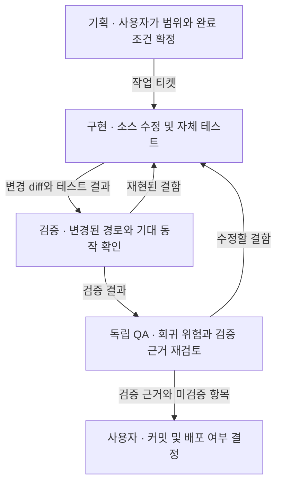

# AI Dev Playbook

레거시 웹 시스템을 개선하면서 만든 AI 코딩 에이전트 협업 가이드입니다. 작업 요청을 분석·구현·검증·커밋 준비로 나누고, 각 단계에서 에이전트가 바꿀 수 있는 대상과 다음 사람이 확인할 근거를 정했습니다.

## 대표 사례 · 신청 폼의 검증 동작 보존

신청 폼의 오류 안내를 개선할 때도 기존 제출 조건은 유지해야 합니다. 예를 들어 `onsubmit="return validate();"`는 검증 함수가 즉시 `false`를 반환해야 제출을 취소합니다. 안내 창을 기다리려고 이 함수를 `async`로 바꾸면 반환값이 `Promise`가 되어 빈 필드가 있어도 제출을 시도할 수 있습니다.

아래 문서는 이 문제를 어떤 순서로 판단하고 기록하는지 보여주는 예시입니다.

| 단계 | 판단과 확인 근거 |
|---|---|
| [분석 보고서](examples/sample-analysis-report.md) | URL에서 화면 JSP까지 추적해 수정 후보를 한 파일로 좁히고, 그대로 유지해야 할 동기 반환 동작을 기록합니다. |
| [결함 티켓](examples/sample-defect-report.md) | 빈 필드에 초점이 돌아왔는지, 브라우저가 제출을 시도했는지 로컬 모의 화면에서 각각 확인하는 방법을 보여줍니다. |
| [커밋 준비서](examples/sample-commit-prep.md) | 정적 검사 결과와 브라우저에서 확인한 동작을 기록하고, 스크린리더 확인은 미검증으로 남깁니다. |

## 에이전트 간 역할과 인계

신청 폼 사례에서 기획자가 정한 완료 조건은 “필수값이 비었을 때 오류를 안내하고 제출을 취소한다”입니다. 아래 흐름은 그 조건이 구현과 독립 검증을 거쳐 사용자에게 돌아오는 과정을 보여줍니다. 표의 도구는 역할을 나누는 한 가지 예입니다.

| 역할 | 도구 예시 | 다음 담당자에게 넘기는 내용 |
|---|---|---|
| 기획·명세 | 사용자와 ChatGPT | 대상 화면, 유지할 제출 조건, 허용한 수정 범위를 담은 작업 티켓 |
| 구현 | Claude Code | 기준 커밋 또는 SVN 리비전, 수정한 파일의 diff, 자체 테스트 결과 |
| 검증 | Gemini | 빈 필드 제출을 시도한 재현 절차, 오류 안내와 제출 취소를 관찰한 결과 |
| 독립 QA | Codex | diff와 검증 기록을 대조한 결과, 남은 회귀 위험, 스크린리더 등 미검증 항목과 사유 |

검증과 독립 QA는 소스를 읽기 전용으로 확인합니다. 결함은 재현 조건과 함께 구현 담당자에게 돌려보내고, 사용자는 검증 기록을 보고 커밋과 배포를 각각 결정합니다. [에이전트 간 인계 지침](modules/multi-agent-and-docs.md)

## 설계 결정

- **읽을 지침을 작업 단계별로 나눴습니다.** 공통 권한과 기존 변경 보호 원칙은 [AGENTS.md](AGENTS.md)에 두고, 구체적인 절차는 [분석](guidelines/01-analysis.md), [구현](guidelines/02-implementation.md), [검증](guidelines/03-verification.md), [커밋·기록](guidelines/04-commit-record.md)에서 필요한 문서만 읽습니다.
- **구현과 검증을 다른 사람이 이어받을 수 있게 했습니다.** 구현자는 변경 파일과 의도를 남기고, 검증자는 diff와 재현 절차를 기준으로 결과를 확인합니다. 실행하지 못한 항목에는 이유를 적습니다. [에이전트 간 인계 지침](modules/multi-agent-and-docs.md)
- **검증 수단마다 확인할 수 있는 범위를 명시했습니다.** 브라우저 시험에서는 최종 신청·결제 등 금지할 조작을 지정합니다. JSP 정적 검사는 커스텀 태그의 속성 구문을 점검하고, 키보드 조작과 초점 이동은 렌더링된 화면에서 확인합니다. [브라우저 시험 프롬프트](prompts/unit-test-execution-prompt.md) · [정적 검사 도구](tools/README.md)
- **환경에 따라 달라지는 규칙은 선택 모듈로 분리했습니다.** 예를 들어 레거시 폼의 동기 검증을 유지하는 규칙과 Windows에서 SVN 커밋 메시지의 UTF-8 인코딩을 지정하는 규칙은 해당 환경에서 적용합니다. [레거시 웹](modules/legacy-web-guardrails.md) · [SVN과 Windows](modules/vcs-svn-windows.md) · [접근성](modules/web-a11y-kwcag.md)

## 프로젝트에 적용하기

1. 저장소의 디렉터리 구조를 유지해 프로젝트 루트에 적용합니다. 지침은 `guidelines/`, 재사용할 프롬프트는 `prompts/`, 검사 도구는 `tools/`에 둡니다. Claude Code용 [CLAUDE.md](CLAUDE.md)는 공통 지침을 참조합니다.
2. [PROJECT.template.md](PROJECT.template.md)를 루트의 `PROJECT.md`로 복사합니다. 작업 경로, 보호할 파일, 사용할 모듈을 채웁니다. 프로젝트별 설정은 [기본 Git 제외 규칙](.gitignore)으로 보호합니다. 기존 저장소에 적용할 때는 해당 제외 규칙도 함께 반영합니다.
3. 분석할 화면과 허용 범위를 지정합니다. 예를 들어 다음처럼 요청할 수 있습니다.

   > AGENTS.md와 guidelines/01-analysis.md를 읽고 신청 폼의 URL에서 화면 JSP까지 호출 흐름을 추적해 주세요. 필수 입력이 비었을 때 폼 제출을 취소하는 코드를 찾아 파일 경로와 함께 설명해 주세요. 소스는 그대로 두고 결과를 docs/analysis/apply-form.md에 기록해 주세요.

4. 수정할 항목이 결정되면 분석 보고서와 함께 구현을 요청합니다. 이후 검증자에게 변경 diff, 기대 동작, 확인할 환경을 넘깁니다. 프로젝트별 분석은 `docs/analysis/`, 커밋 준비서는 `docs/planning/`, 시험 결과는 `docs/testing/`에 보관합니다.

브라우저 시험을 반복할 때는 [시나리오 생성 및 실행 안내](prompts/README.md)를 참고하세요. 외부 도구를 연결하는 프로젝트에는 [MCP 설정 예시](.mcp.example.json), [MCP 권한 지침](modules/mcp-setup-and-governance.md), [Notion 기록 절차](modules/docs-notion-sync.md)가 있습니다.
