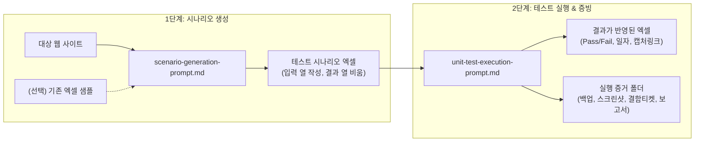

# AI 기반 웹 단위테스트 자동화 프롬프트 툴킷

웹 사이트의 화면을 분석하여 **표준 테스트 시나리오 엑셀을 자동 생성**하고, 이를 바탕으로 **브라우저를 자동 조작해 기능을 검증하고 엑셀에 결과와 화면 캡처를 기록**하는 AI 에이전트 전용 프롬프트 툴킷입니다.

---

## 1. 툴킷 구성 및 파이프라인 개요

**[1단계: 시나리오 생성] → [2단계: 테스트 실행 & 증빙]**의 2단계 파이프라인으로 구성되어 있으며, 두 프롬프트는 데이터 스키마와 엑셀 열 매핑이 1:1로 호환됩니다.



---

## 2. 파일 목록 및 역할

| 파일명 | 구분 | 주요 역할 |
|---|---|---|
| [`README.md`](README.md) | **가이드** | 툴킷 사용 설명서, 호출 문구 예시, 파라미터 치트시트 |
| [`scenario-generation-prompt.md`](scenario-generation-prompt.md) | **1단계 (생성)** | 웹 페이지 DOM 분석 기반 시나리오 엑셀 자동 도출 (샘플 서식 학습 지원) |
| [`unit-test-execution-prompt.md`](unit-test-execution-prompt.md) | **2단계 (실행)** | 엑셀 시나리오 기반 브라우저 자동화 실행, 결과 기록, 증빙 캡처, 결함 리포트 |

---

## 3. 사전 준비 사항

```powershell
# 1. 필수 Python 패키지 설치
pip install openpyxl playwright axe-playwright-python

# 2. Playwright 브라우저 바이너리(Chromium) 설치
playwright install chromium

# 3. 대상 로컬/개발 웹 서버 구동 확인
Test-NetConnection -ComputerName localhost -Port 8080
```

---

## 4. 빠른 시작 가이드 (호출 예시)

### [STEP 1] 테스트 시나리오 엑셀 생성하기

> `"prompts/scenario-generation-prompt.md 읽고, TARGET_SITE.target_urls에 ['/main.do'] 등록해서 메인 시나리오 엑셀을 만들어줘. 샘플 파일은 ./sample.xlsx 를 참고해줘."`

- **기존 엑셀 샘플이 있는 경우**: `sample_template_path`에 파일 경로를 지정하면 헤더·컬럼 위치·서식·문장 스타일을 복제해 생성합니다.
- **샘플 파일이 없는 경우**: `null`로 두면 표준 서식으로 신규 생성합니다.

### [STEP 2] 테스트 실행 및 결과/증빙 기록하기

> `"prompts/unit-test-execution-prompt.md 읽고, 방금 만든 시나리오 엑셀에 대해 로컬 8080 서버를 대상으로 전수 테스트를 실행하고 결과와 캡처를 기록해줘."`

> `"prompts/unit-test-execution-prompt.md 읽고, run_mode는 failed_only로 설정해서 방금 고친 결함 항목들만 선별 재실행해줘."`

---

## 5. 상황별 파라미터 추천 설정

### 상황 A. 감리·최종 제출용 (전수 캡처 모드)
```yaml
EXECUTION_MODE:
  run_mode: "all"
SCREENSHOT_CONFIG:
  policy: "all"                  # 모든 스텝 전수 캡처
  link_method: "hyperlink"       # 엑셀 셀에 클릭 시 열리는 =HYPERLINK() 삽입
A11Y_AUDIT_INTEGRATION:
  enabled: true                  # 웹 접근성 진단 요약도 함께 수집
```

### 상황 B. 결함 조치 후 빠른 회귀 검증 (초고속 모드)
```yaml
EXECUTION_MODE:
  run_mode: "failed_only"        # 이전 Fail 항목만 선별 재실행
SCREENSHOT_CONFIG:
  policy: "failure_only"         # 실패 항목만 캡처 갱신
DEFECT_REPORTING:
  generate_defect_reports: true  # 남아있는 결함 티켓 갱신
```

### 상황 C. 작업 중단 후 이어하기 (증분 모드)
```yaml
EXECUTION_MODE:
  run_mode: "untested_only"      # 결과(H열)가 빈칸인 행만 이어서 실행
```

---

## 6. 산출물 구조 및 안전 수칙

```text
단위테스트_실행증거_<YYYYMMDD_HHMMSS>/
├── backup/                        # 수정 전 원본 엑셀 및 SHA-256 해시
├── screenshots/                   # 스텝별 캡처 PNG
├── defects/                       # Fail 스텝별 마크다운 결함 티켓
├── a11y-summary.json              # 접근성 동시 진단 요약 (옵션)
├── execution-results.json         # 전체 실행 결과 로그
└── 단위테스트_실행결과_보고서.md  # 종합 요약 보고서
```

- **DB/결제 오염 차단**: 최종 신청·결제·삭제 Submit 버튼은 누르지 않고 유효성 안내 및 확인 팝업 취소(Cancel)까지만 검증합니다.
- **자격증명 보호**: 실제 로그인 ID/비밀번호는 환경변수로만 주입하고 결과 문서·엑셀·로그에는 `테스트 계정 A` 등 가명 식별자만 기록합니다.
